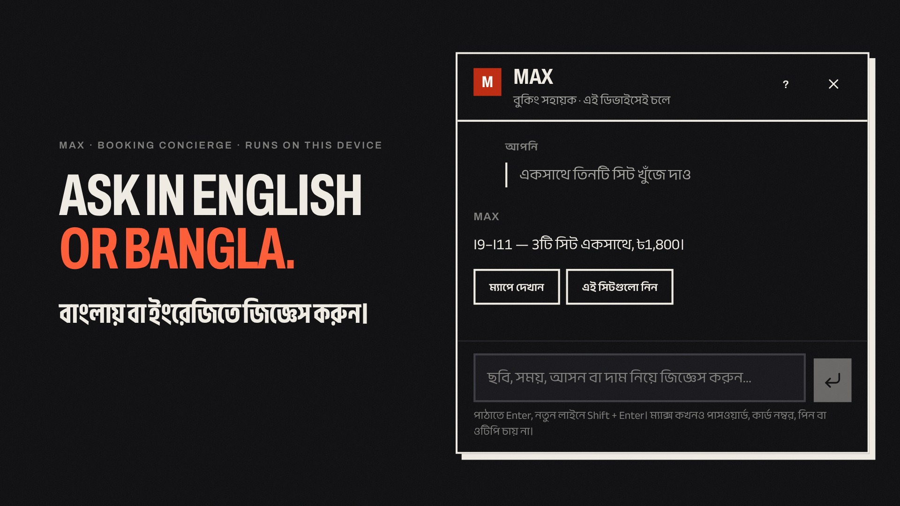

# GrandPlex

Movie discovery and ticket booking, with **Max**: a booking concierge that runs on your device and
answers in English or Bangla.

[](docs/media/grandplex-launch.mp4)

▶ **[Watch the 21-second walkthrough](docs/media/grandplex-launch.mp4)** (MP4, 1080p, with sound):
asking Max for seats in English and Bangla, choosing them on the seat map, and printing the ticket.

> [!NOTE]
> GrandPlex is a **demonstration build**, not a real cinema chain. Venues, schedules, seat
> availability, prices, offers and policies are sample data written for this project. The fourteen
> films are real releases, shown with TMDB artwork and their official trailers. No payment is taken,
> nothing is sent anywhere, and bookings are stored only in your browser.

## Contents

- [Features](#features)
- [Max, the booking concierge](#max-the-booking-concierge)
- [Design](#design)
- [Getting started](#getting-started)
- [Quality gates](#quality-gates)
- [Project structure](#project-structure)
- [Tech stack](#tech-stack)
- [Content and media](#content-and-media)
- [Limitations](#limitations)
- [Documentation](#documentation)

## Features

### Booking

- **Guest checkout in seven steps:** screening, tickets, seats, add-ons, your details, payment and
  review. There is no account, login or password. Selections survive a refresh and back navigation,
  and changing an earlier choice clears only what it invalidates.
- **An accessible seat map:** deterministic availability, five seat classes, aisles, and wheelchair
  spaces with companion seats. It is a real multi-select `listbox` with arrow-key navigation, a single
  roving tab stop, per-seat accessible names and polite live announcements. No state relies on
  colour alone.
- **A confirmation worth keeping:** a box-office printer feeds out the receipt with its QR code. The
  booking can be printed, added to a calendar as an `.ics` file, or reopened from local booking
  history.

### Programme

- Fourteen films, each with its official trailer (privacy-enhanced YouTube embeds, no autoplay) and a
  spoiler-free story in English and Bangla.
- Five venues across Dhaka, Chattogram and Sylhet. Each one is shown as a diagram of its screens,
  sized by seat count (seventeen screens in all).
- Showtimes, concessions with dietary and allergen information (incomplete allergen data is flagged,
  never glossed over), offers and published ticket prices.

### Everywhere

- English and Bangla, in light or dark. Both preferences are applied before first paint, so neither
  flashes on load. Some long-form prose on the About, Contact and Ticket prices pages is still
  English-only. `check:untranslated` keeps that count from growing.
- Fifteen routes, including local booking history and a 404 page that suggests what is showing.

## Max, the booking concierge

Max is a deterministic natural-language interface to the application's own logic, not a chat model.
Each message is parsed into a typed intent with entities. A skill turns that parse, together with
what the customer is currently looking at, into a typed reply made of response blocks and actions.
The interface renders the blocks and an executor runs the actions.

**Max cannot invent a price, a showtime or a seat.** Those values are computed by the same functions
the booking wizard uses and passed through as structured data. Nothing parses Max's prose to decide
what to do.

Ask in English or Bangla:

| Where you are | Ask |
| --- | --- |
| Showtimes | "Show me sci-fi movies playing after 8 PM tonight" |
| Tickets step | "What is the cheapest way to book for four people?" |
| Seats step | "Find three seats together", or in Bangla, "একসাথে তিনটি সিট খুঁজে দাও" |
| Seats step | "I need a wheelchair space and a companion seat" |
| Any booking step | "ছবিটা কতক্ষণের?" (How long is this film?) |

Max never completes a purchase. It asks before changing seats, tickets or the basket, and it offers
an undo for every change it makes. It never claims to have contacted staff or to monitor live
inventory, and it never asks for a password, PIN, OTP, card number or date of birth.

**Optional Ollama layer.** When a local Ollama daemon is detected, Max can use `gpt-oss:120b` to
reword its replies, and only to reword them. The option is off by default and appears only when a
daemon is found. Every number must survive the rewrite verbatim, or the rewrite is discarded. No API
key is used.

See [docs/max-assistant.md](docs/max-assistant.md) for the pipeline, providers and guarantees.

## Design

The design system, **Cinematic Monolith**, treats the site as a festival programme made bookable. It
uses a single vermilion accent that only marks actions, selections and live states. Display type is
condensed Archivo. Corners are square, and rules do the structural work that cards usually do.

The product moves between two worlds. **Bone** is the lobby, for browsing and deciding. The
**auditorium** covers the seat map, the screening steps of the booking wizard and the ticket. It
stays dark in both themes, so walking into seat selection always reads as the lights going down.

Fonts are self-hosted, so the site makes no external font requests. It uses Archivo for display and
text at two widths, Anek Bangla for Bengali, and JetBrains Mono for references, times and prices.

See the [design system](docs/design-system.md), [brand system](docs/grandplex-brand-system.md) and
[motion system](docs/motion-system.md).

## Getting started

Requires **Node.js 20 or later** and npm. No environment variables, API keys or external services
are needed.

```bash
git clone https://github.com/SHAYAN-ABRAR/Movie-Booking-Concierge.git
cd Movie-Booking-Concierge
npm install
npm run dev        # http://localhost:5173
```

| Command | What it does |
| --- | --- |
| `npm run dev` | Starts the Vite dev server |
| `npm run build` | Type-checks, then builds for production into `dist/` |
| `npm run preview` | Serves the production build |
| `npm run verify` | Runs every quality gate, in order |
| `npm test` | Runs the Vitest unit and component tests (`npm run test:watch` to watch) |
| `npm run test:e2e` | Runs the Playwright acceptance tests against a production preview |
| `npm run verify:trailers` | Re-checks each trailer's publisher via YouTube oEmbed (needs network) |

Before the first end-to-end run, install a browser with `npx playwright install chromium`. The suite
builds the app, serves it on port 4174, and runs on a desktop and a mobile (Pixel 5) profile.

**Deployment.** The build is a static single-page app. `vercel.json` rewrites every path to
`index.html` so client-side routes resolve on Vercel. Other static hosts need an equivalent fallback.

## Quality gates

`npm run verify` runs these in order and stops at the first failure:

| Gate | Checks |
| --- | --- |
| `typecheck` | TypeScript in strict mode, including `noUncheckedIndexedAccess` |
| `lint` | ESLint. `eval`, `new Function()` and `dangerouslySetInnerHTML` are errors |
| `check:brand` | No stale pre-rebrand name in code, docs or package metadata |
| `validate:content` | The film catalogue stays real, and every rendered image has a recorded source |
| `check:assets` | No image occupies more than one visual slot |
| `check:i18n` | English and Bangla stay in parity, with no empty values or interpolation drift |
| `check:untranslated` | No new English text reaches the interface without a translation key |
| `test` | Vitest |
| `build` | Production build |
| `check:classes` | Every colour utility in the build resolves to a registered token |

The tests cover schedule determinism, pricing and age-category rules, the NLU pipeline in both
languages, seat finding, the seat map's keyboard and ARIA behaviour, preferences, motion tokens and
every route rendering. They also cover honesty guarantees, such as the booking flow never rendering a
password field.

## Project structure

```text
src/
  components/   UI by area: booking, max, receipt, movie, cinema, concessions, layout, ui
  config/       The brand identity, declared once
  data/         Films, cinemas, pricing, policies, media manifests and the schedule engine
  hooks/        Shared React hooks
  i18n/         English and Bangla resources and formatters
  lib/          Pure logic: booking maths, seat finding, dates, formatting, calendar files
  max/          Max: types, NLU pipeline, skills, providers, context and executor
  motion/       Motion tokens and primitives
  routes/       One file per route
  store/        Zustand stores: booking, bookings, preferences, watches, reports, Max
  styles/       Design tokens and global CSS
public/media/   Optimised film, concession, venue and offer images (AVIF, WebP, JPEG)
scripts/        Quality gates and one-off media authoring tools
tests/e2e/      Playwright acceptance tests
docs/           Architecture, design, content and QA records
```

## Tech stack

React 18, TypeScript 5.7, Vite 6 and Tailwind CSS 4, with Radix UI primitives, React Router 6 and
Zustand for persisted state. Forms use React Hook Form and Zod, translation uses i18next, and
animation uses Framer Motion. Dates are handled with date-fns, icons come from Lucide, and QR codes
from qrcode.react. Tests run on Vitest with Testing Library, plus Playwright. Fonts are self-hosted
through Fontsource.

## Content and media

- **Film artwork:** posters and backdrops were downloaded once from TMDB at authoring time and are
  served locally. Per-image attribution lives in
  [`src/data/mediaManifest.ts`](src/data/mediaManifest.ts). This product uses the TMDB API but is not
  endorsed or certified by TMDB.
- **Trailers:** official uploads only, each verified by its publishing channel. See
  [docs/movie-trailer-sources.md](docs/movie-trailer-sources.md).
- **Concession, venue and offer images:** AI-generated illustrations. Each one's provenance and
  prompt are recorded in the
  [concession](docs/concession-ai-image-manifest.md), [venue](docs/venue-ai-image-manifest.md) and
  [offer](docs/offer-ai-image-manifest.md) image manifests.
- **Venues, schedules, prices, offers and policies:** sample data written for this project.

## Limitations

- **Frontend only.** There is no backend, database, account system or payment processor. Bookings
  are kept in `localStorage`, so they belong to one browser.
- **Generated schedule.** Screenings and seat availability come from a deterministic local engine,
  not live inventory. The same screening always shows the same sold seats.
- **Max knows only this repository's data.** It cannot contact staff, submit a report or complete a
  purchase.
- **Demonstration tickets.** Every ticket is marked "Demonstration ticket · Not valid for entry".

## Documentation

| Topic | Documents |
| --- | --- |
| Max | [max-assistant.md](docs/max-assistant.md) |
| Design | [design-system.md](docs/design-system.md) · [grandplex-brand-system.md](docs/grandplex-brand-system.md) · [motion-system.md](docs/motion-system.md) · [design-directions.md](docs/design-directions.md) |
| Language and theme | [language-theme-audit.md](docs/language-theme-audit.md) · [bangla-glossary.md](docs/bangla-glossary.md) |
| Content and media | [movie-trailer-sources.md](docs/movie-trailer-sources.md) · [movie-story-content.md](docs/movie-story-content.md) · [asset-inventory.md](docs/asset-inventory.md) · AI image manifests for [concessions](docs/concession-ai-image-manifest.md), [venues](docs/venue-ai-image-manifest.md) and [offers](docs/offer-ai-image-manifest.md) |
| Quality | [qa-report.md](docs/qa-report.md) · [grandplex-upgrade-qa.md](docs/grandplex-upgrade-qa.md) · [visual-revival-qa.md](docs/visual-revival-qa.md) · [cinematic-monolith-qa.md](docs/cinematic-monolith-qa.md) · [tooling-report.md](docs/tooling-report.md) |
| History | [grandplex-migration.md](docs/grandplex-migration.md) · [grandplex-upgrade-audit.md](docs/grandplex-upgrade-audit.md) · [visual-revival-audit.md](docs/visual-revival-audit.md) · [reference-audit.md](docs/reference-audit.md) · [booking-confirmation-root-cause.md](docs/booking-confirmation-root-cause.md) · [limitations.md](docs/limitations.md) |
